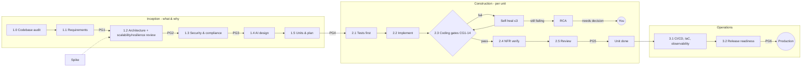

# AI-DLC for Claude Code

**An AI-Driven Development Lifecycle that takes a product from idea to production with Claude Code: gated phases, 19 specialist agents, automated coding gates, and artifacts that hold up to review by a senior architect, an auditor or an enterprise client.**

AI proposes and executes. You approve at every phase gate. Coding gates are enforced automatically: no unit of work reaches review with a red gate.



## Why
Most "AI writes code" workflows skip what makes software production-grade: quantified requirements, written
architecture decisions, threat models, test-first delivery, measurable quality gates and an operations plan.
AI-DLC encodes those practices into Claude Code so every project produces the evidence by default.

## Install

**As a Claude Code plugin (recommended)**
```bash
claude plugin marketplace add tijo-thomaz/claude-aidlc
claude plugin install aidlc@claude-aidlc
```
Or from inside a session: `/plugin marketplace add tijo-thomaz/claude-aidlc`, then `/plugin install aidlc@claude-aidlc`.
Update later with `claude plugin update aidlc@claude-aidlc`. With a plugin install the skill is namespaced, so the
commands below start with `/aidlc:aidlc` instead of `/aidlc`.

**Manual install**
```bash
git clone https://github.com/tijo-thomaz/claude-aidlc
cd claude-aidlc
./install.sh                     # macOS / Linux / WSL  (add --project to install into ./.claude)
powershell -File install.ps1     # Windows              (add -Project to install into .\.claude)
```
Restart Claude Code after installing.

## Quick start
```
/aidlc                       start a project: it asks for intent, users, work type, deploy target, PII?, AI?
/aidlc status                where are we? phase, last gate, next step, blockers
/aidlc audit                 full audit of an existing codebase: decisions, drawbacks, edge cases, roadmap
/aidlc gates U-02            run coding gates for a unit (with the self-heal -> RCA loop)
/aidlc spike <question>      time-boxed investigation that ends in an ADR recommendation
/aidlc rca <bug/incident>    blameless root-cause analysis with a regression test and CAPA
```
To run the orchestrator as your main session: `claude --agent aidlc-orchestrator`.

Everything is written to `aidlc-docs/` in your project: state, an append-only audit log, a compressed memory file,
and every artifact. You can stop and resume at any point.

## The agents
| Phase | Agent | Produces |
|-------|-------|----------|
| Control | `aidlc-orchestrator` | Routing, gate enforcement, failure loops |
| | `aidlc-context-keeper` | `context.min.md`: the whole project state in under 800 words, so agents spend fewer tokens |
| Inception | `aidlc-codebase-auditor` | Reconstructed ADRs, graded findings, edge cases, modernisation roadmap |
| | `aidlc-product-analyst` | PRD, INVEST stories, Given/When/Then criteria, quantified NFRs |
| | `aidlc-architect` | C4 diagrams, ADRs, NFR → tactic mapping, cost estimate |
| | `aidlc-scalability` | Load model, capacity plan, bottlenecks, k6 load tests |
| | `aidlc-robustness` | FMEA, timeout budgets, fault-injection and property-based tests |
| | `aidlc-security-architect` | STRIDE threat model, ASVS requirements, GDPR / EU AI Act / NIS2 assessment |
| | `aidlc-ai-engineer` | Model choice, RAG/agent design, eval suite, guardrails, cost budget |
| | `aidlc-spike` | Time-boxed experiment with evidence and a draft ADR |
| | `aidlc-planner` | Vertical-slice units of work, dependency graph, traceability matrix |
| Construction | `aidlc-test-engineer` | Test plan and failing tests first |
| | `aidlc-developer` | Implementation that follows the ADRs and patterns |
| | `aidlc-code-quality` | `gates.yml`, gate runner, CG1–CG14 results with evidence |
| | `aidlc-self-heal` | Bounded fixes for failed gates; it may not weaken tests or thresholds |
| | `aidlc-rca` | 5 Whys, contributing factors, regression test, preventive actions |
| | `aidlc-reviewer` | Correctness, security and design review (runs only once the gates are green) |
| Operations | `aidlc-devops` | CI/CD running the same gates, IaC, SLOs, auto-rollback |
| | `aidlc-release-manager` | Evidence-based release checklist, runbook, changelog, handover |

## Quality gates
Coding gates run for every unit. These are the defaults; a project overrides them in `aidlc-docs/gates.yml`, and
each override needs an ADR:

| Gate | Default threshold |
|------|-------------------|
| CG1–CG3 Build, lint, types | Clean; strict type-check |
| CG4 Tests | 100% pass, 3 runs to catch flakiness |
| CG5 Coverage | Diff coverage ≥ 80%, branch ≥ 70% |
| CG6 Mutation | ≥ 60% on the domain core (product work only) |
| CG7 Complexity | Cyclomatic ≤ 10, functions ≤ 50 lines |
| CG8 Duplication | ≤ 3% |
| CG9 Architecture | No cycles; layer rules enforced |
| CG10 Security | No critical/high SAST or CVE findings; no secrets; licence policy |
| CG11 Robustness | Timeouts, idempotent retries, tested error paths |
| CG12 Performance | p95 within the NFR budget (hot paths) |
| CG13 AI evals | Pass rate ≥ threshold; no regression > 2 points |
| CG14 Docs | APIs, ADRs and changelog updated |

There is tooling guidance for Python, TypeScript, Java, .NET and Go. A gate passes only on evidence; a tool that
can't run marks the gate **BLOCKED**, never PASS.

## What's inside
```
.claude-plugin/          plugin + marketplace manifests
skills/aidlc/SKILL.md    the lifecycle (orchestrator instructions)
skills/aidlc/references/
  quality-gates.md       phase gates, coding gates, tooling per stack, failure loop, gates.yml template
  patterns.md            ~90 patterns by usage, with use-when / avoid-when, plus anti-patterns
  standards.md           ISO 25010/29148, C4, ADR, OWASP ASVS/Top 10/LLM Top 10, NIST SSDF, GDPR, EU AI Act, WCAG
  templates.md           PRD, story, ADR, threat model, unit, review templates
  state-template.md      project state tracker
agents/                  19 aidlc-* subagents
```

## Adaptive depth
| Work type | Runs |
|-----------|------|
| `spike` | lightweight requirements → spike → implement → CG1/CG2/CG4 |
| `feature` | audit, requirements, security, plan, the full construction loop, CI deltas |
| `product` | every stage and every gate |

## Limitations
- Compliance output (GDPR, EU AI Act, NIS2) is an engineering assessment, **not legal advice**.
- Gates depend on the tools available in your environment. Missing tools are reported as BLOCKED.
- Subagents cannot spawn subagents. The lifecycle runs from the `/aidlc` skill or from `claude --agent aidlc-orchestrator`.
- Running every stage of a full product costs a lot of tokens. Use the `spike` or `feature` depth for smaller work.

## Contributing
Issues and PRs are welcome: new gates, stack tooling, patterns, or agents. Keep agents focused on one stage,
evidence-driven and token-lean. See [CONTRIBUTING.md](CONTRIBUTING.md).

## License
[MIT](LICENSE) © 2026 Tijo Thomas
